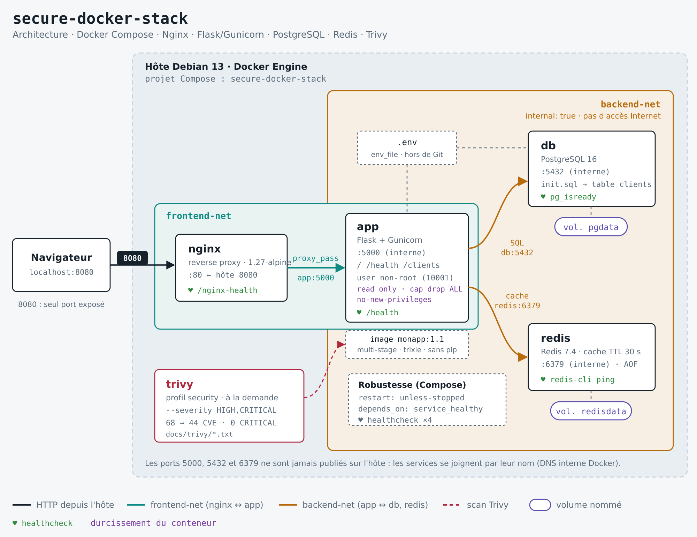

# secure-docker-stack

Application web multi-conteneurs sécurisée, orchestrée avec Docker Compose : reverse proxy Nginx, API Python Flask, base PostgreSQL, cache Redis, isolation réseau, healthchecks, persistance des données et analyse de vulnérabilités avec Trivy.

**Stack :** Docker 29 · Docker Compose v5 · Nginx 1.27 · Python 3.13 / Flask / Gunicorn · PostgreSQL 16 · Redis 7.4 · Trivy 0.76 · Debian 13

---

## Sommaire

1. [Architecture](#architecture)
2. [Structure du projet](#structure-du-projet)
3. [Démarrage rapide](#démarrage-rapide)
4. [Variables d'environnement](#variables-denvironnement)
5. [Commandes utiles](#commandes-utiles)
6. [Vérifications](#vérifications)
7. [Sécurité](#sécurité)
8. [Analyse des vulnérabilités avec Trivy](#analyse-des-vulnérabilités-avec-trivy)
9. [Limites et pistes d'amélioration](#limites-et-pistes-damélioration)
10. [Problèmes rencontrés](#problèmes-rencontrés)

---

## Architecture



Suivi détaillé des étapes de construction : [`docs/suivi-phases.html`](docs/suivi-phases.html)

### Services

| Service | Image | Rôle | Réseaux | Port |
|---|---|---|---|---|
| `nginx` | `nginx:1.27-alpine` | Reverse proxy, point d'entrée unique | frontend-net | **8080 → 80** (publié) |
| `app` | `monapp:1.1` (construite) | API Flask servie par Gunicorn | frontend-net, backend-net | 5000 (interne) |
| `db` | `postgres:16` | Stockage des clients | backend-net | 5432 (interne) |
| `redis` | `redis:7.4-alpine` | Cache des réponses `/clients` (TTL 30 s) | backend-net | 6379 (interne) |
| `trivy` | `aquasec/trivy:0.76.1` | Scan de vulnérabilités, lancé à la demande | réseau par défaut | — |

### Flux autorisés

| Source → destination | Port | Réseau |
|---|---|---|
| Navigateur → nginx | 8080 → 80 | hôte |
| nginx → app | 5000 | frontend-net |
| app → db | 5432 | backend-net |
| app → redis | 6379 | backend-net |

Nginx n'est pas connecté à `backend-net` : même compromis, il ne peut pas joindre la base de données ni le cache. Les services se joignent par leur nom, grâce au DNS interne de Docker (`127.0.0.11`).

### Routes de l'API

| Route | Description |
|---|---|
| `GET /` | Message d'accueil |
| `GET /health` | Contrôle de vie de l'application (liveness) |
| `GET /clients` | Liste des clients : lecture dans Redis, sinon dans PostgreSQL. Le champ `source` indique `cache` ou `database`. |

---

## Structure du projet

```
secure-docker-stack/
├── compose.yaml            # Orchestration des 5 services
├── .env.example            # Modèle de configuration (versionné)
├── .env                    # Secrets réels (NON versionné)
├── .gitignore
├── .gitattributes          # Fins de ligne LF pour les conteneurs Linux
├── README.md
├── app/
│   ├── Dockerfile          # Multi-stage, utilisateur non-root
│   ├── .dockerignore
│   ├── requirements.txt    # Versions figées
│   └── app.py
├── nginx/
│   └── default.conf        # proxy_pass vers app:5000, en-têtes de sécurité
├── db/
│   └── init.sql            # Création de la table clients au premier démarrage
└── docs/
    ├── tests.md            # Résultats des tests de validation
    └── trivy/              # Rapports Trivy avant / après correction
```

---

## Démarrage rapide

### Prérequis
- Docker Engine 24 ou plus récent, avec le plugin Docker Compose v2
- Port 8080 libre sur l'hôte

### Installation

```bash
git clone https://github.com/slimanebou/secure-docker-stack.git
cd secure-docker-stack

# Créer la configuration à partir du modèle
cp .env.example .env
openssl rand -base64 24        # génère un mot de passe : le coller dans POSTGRES_PASSWORD
nano .env
chmod 600 .env

# Construire et démarrer
docker compose up -d --build
docker compose ps              # les 4 services doivent être (healthy)
```

### Test

```bash
curl http://localhost:8080/
curl http://localhost:8080/health
curl http://localhost:8080/clients
```

Ordre de démarrage, imposé par `depends_on: condition: service_healthy` :

```
db (healthy) → redis (healthy) → app (healthy) → nginx
```

---

## Variables d'environnement

Définies dans `.env` (jamais versionné) et injectées par `env_file`.

| Variable | Utilisée par | Description | Exemple |
|---|---|---|---|
| `POSTGRES_DB` | db, app | Nom de la base | `appdb` |
| `POSTGRES_USER` | db, app | Utilisateur PostgreSQL | `appuser` |
| `POSTGRES_PASSWORD` | db, app | Mot de passe (secret) | généré par `openssl rand` |

Définies directement dans `compose.yaml` (non sensibles) :

| Variable | Service | Valeur | Rôle |
|---|---|---|---|
| `DB_HOST` | app | `db` | Nom DNS du service PostgreSQL |
| `DB_PORT` | app | `5432` | Port PostgreSQL |
| `REDIS_HOST` | app | `redis` | Nom DNS du service Redis |
| `REDIS_PORT` | app | `6379` | Port Redis |
| `CACHE_TTL` | app | `30` (défaut) | Durée de vie du cache, en secondes |

---

## Commandes utiles

| Action | Commande |
|---|---|
| Démarrer | `docker compose up -d` |
| Reconstruire l'image et démarrer | `docker compose up -d --build` |
| État et santé des services | `docker compose ps` |
| Logs de tous les services | `docker compose logs --tail 50` |
| Logs d'un service en temps réel | `docker compose logs -f nginx` |
| Logs de l'app sans les healthchecks | `docker compose logs app \| grep -v /health` |
| Arrêter sans supprimer | `docker compose stop` |
| Supprimer conteneurs et réseaux (données conservées) | `docker compose down` |
| Tout supprimer, **données comprises** | `docker compose down -v` |
| Ouvrir psql | `docker compose exec db sh -c 'psql -U "$POSTGRES_USER" -d "$POSTGRES_DB"'` |
| Lancer le scan Trivy | `docker compose --profile security run --rm trivy` |

---

## Vérifications

Le détail des résultats est dans [`docs/tests.md`](docs/tests.md).

### Persistance

```bash
# Ajouter un client
docker compose exec -T db sh -c 'psql -U "$POSTGRES_USER" -d "$POSTGRES_DB"' << 'EOF'
INSERT INTO clients (nom, email) VALUES ('Test Persistance', 'persistance@example.com');
EOF

# Recréer le conteneur : son ID change, la donnée reste
docker compose up -d --force-recreate db
docker compose exec redis redis-cli DEL clients
curl -s localhost:8080/clients | grep -o 'Test Persistance'
```

Au redémarrage, PostgreSQL affiche `Database directory appears to contain a database; Skipping initialization` : le volume est conservé et `init.sql` n'est pas rejoué.

### Isolation réseau

| Test | Commande | Résultat attendu |
|---|---|---|
| nginx joint app | `docker compose exec nginx wget -qO- http://app:5000/health` | `{"status":"ok"}` |
| nginx ne voit pas db | `docker compose exec nginx ping -c 1 db` | `bad address 'db'` |
| redis sans Internet | `docker compose exec redis ping -c 1 8.8.8.8` | `Network unreachable` |
| Port 5000 fermé sur l'hôte | `curl localhost:5000` | Connexion refusée |

### Cache et dégradation gracieuse

| Test | Résultat |
|---|---|
| 1ᵉʳ appel à `/clients` | `"source":"database"` |
| 2ᵉ appel (moins de 30 s après) | `"source":"cache"` |
| Redis arrêté (`docker compose stop redis`) | `"source":"database"`, HTTP 200 : l'application continue sans cache |

---

## Sécurité

| Mesure | Mise en œuvre |
|---|---|
| Point d'entrée unique | Seul Nginx publie un port (8080) |
| Segmentation réseau | `frontend-net` / `backend-net`, ce dernier en `internal: true` |
| Secrets hors du code | `.env` exclu de Git, `.env.example` versionné avec des valeurs factices |
| Image minimale | Dockerfile multi-stage, base `python:3.13-slim-trixie`, pip retiré de l'image finale |
| Moindre privilège | Utilisateur `appuser` (UID 10001), code appartenant à root, en lecture seule pour l'app |
| Durcissement du conteneur `app` | `read_only: true`, `tmpfs: /tmp`, `no-new-privileges:true`, `cap_drop: ALL` |
| En-têtes HTTP | `server_tokens off`, `X-Content-Type-Options`, `X-Frame-Options`, `Referrer-Policy` |
| Montages de configuration | `default.conf` et `init.sql` montés en lecture seule (`:ro`) |
| Reproductibilité | Tags d'image fixes (`monapp:1.1`, `postgres:16`…), dépendances Python figées |
| Résilience | Healthchecks sur les 4 services applicatifs, `restart: unless-stopped` |

Vérification du durcissement :

```bash
docker compose exec app sh -c 'touch /app/test'                      # Read-only file system
docker compose exec app grep -E 'NoNewPrivs|CapEff' /proc/1/status   # NoNewPrivs: 1, CapEff: 0000000000000000
docker compose exec app id                                           # uid=10001(appuser)
```

---

## Analyse des vulnérabilités avec Trivy

### Commandes

```bash
# Scan des vulnérabilités HIGH et CRITICAL
trivy image --severity HIGH,CRITICAL monapp:1.1

# Rapport enregistré
trivy image --severity HIGH,CRITICAL --format table \
  --output docs/trivy/apres-monapp-1.1.txt monapp:1.1

# Barrière de type CI : échoue s'il existe une CVE avec correctif disponible
trivy image --severity HIGH,CRITICAL --ignore-unfixed --exit-code 1 monapp:1.1

# Via Compose (5ᵉ service, profil security)
docker compose --profile security run --rm trivy
```

### Résultats avant / après correction

| | `monapp:1.0` | `monapp:1.1` | Évolution |
|---|:-:|:-:|:-:|
| Image de base | Debian 12.15 (bookworm) | Debian 13.7 (trixie) | |
| Paquets système | 97 | 87 | −10 |
| CVE HIGH + CRITICAL | 68 | **44** | **−35 %** |
| CRITICAL | 3 | **0** | −3 |
| HIGH | 65 | 44 | −21 |
| CVE avec correctif disponible | 5 | **0** | −5 |
| Barrière `--ignore-unfixed --exit-code 1` | échec | **réussite (code 0)** | |

Rapports complets : [`docs/trivy/`](docs/trivy/).

### Analyse du premier scan

**5 CVE Python, toutes corrigeables.** Elles ne venaient pas des dépendances de l'application (flask, gunicorn, psycopg et redis étaient sans vulnérabilité), mais des bibliothèques **embarquées par pip** (`pip/_vendor` : certifi, msgpack, urllib3, pkg_resources), détectées par Trivy grâce au SBOM fourni par pip :

| CVE | Paquet | Gravité | Version installée | Version corrective |
|---|---|---|---|---|
| GHSA-6q48-6c7w-9gw2 | certifi | CRITICAL | 2026.6.17 | 2026.10.19 |
| GHSA-6v7p-g79w-8964 | msgpack | HIGH | 1.1.2 | 1.2.1 |
| CVE-2025-47273 | setuptools | HIGH | 70.3.0 | 78.1.1 |
| CVE-2026-97687 | urllib3 | HIGH | 2.7.0 | 2.8.0 |
| CVE-2026-97689 | urllib3 | HIGH | 2.7.0 | 2.8.0 |

**63 CVE système, aucune corrigeable sous Debian 12** (statuts `affected`, `fix_deferred`, `will_not_fix`). Les deux CRITICAL système :
- **zlib CVE-2023-45853** : la faille est dans le composant *minizip*, que Debian ne compile pas dans `zlib1g` (`will_not_fix`). Non exploitable ici.
- **sqlite CVE-2025-7458** : bibliothèque présente comme dépendance de Python, mais non utilisée par l'application.

### Corrections appliquées

| Correction | Effet |
|---|---|
| Suppression de pip du venv et de l'image de base | Les 5 CVE Python disparaissent : pip n'est utile qu'à la construction |
| Passage de `bookworm` à `trixie` | Paquets plus récents : suppression des CVE sqlite, zlib, gzip, openssl et de 2 CVE util-linux |
| `apt-get upgrade` dans l'étape finale | Intègre les correctifs publiés après la sortie de l'image de base |
| Nouveau tag `monapp:1.1` | `monapp:1.0` conservée pour comparer avant et après |

### Vulnérabilités résiduelles (sans correctif disponible)

Les 44 occurrences restantes correspondent à **8 CVE distinctes**, toutes HIGH, aucune corrigée par Debian 13 à la date du scan (21/10/2026) :

| CVE | Statut | Paquets concernés | Exposition et mesure de réduction du risque |
|---|---|---|---|
| CVE-2026-76642<br/>CVE-2026-78408<br/>CVE-2026-78409<br/>CVE-2026-78410 | affected | util-linux, mount, login, bsdutils, libmount1, libblkid1… (9 paquets) | Exploitation par `mount` / `nsenter` en tant que root. Neutralisée par l'utilisateur non-root, `no-new-privileges` (setuid sans effet) et `cap_drop: ALL` (pas de `CAP_SYS_ADMIN`). |
| CVE-2025-69720 | affected | ncurses (4 paquets) | Bibliothèque de terminal, non utilisée par l'application (aucun terminal interactif). |
| CVE-2026-54369 | affected | libacl1 | Traversée de liens symboliques : nécessite d'écrire des fichiers. Bloquée par `read_only: true` et l'utilisateur non-root. |
| CVE-2026-16742 | affected | libsystemd0, libudev1 | Concerne le démon `systemd-homed`, qui ne tourne pas dans le conteneur (seules les bibliothèques sont présentes). |
| CVE-2026-9538 | fix_deferred | perl-base | Déni de service via une archive tar piégée. Perl n'est pas utilisé par l'application, qui ne traite aucune archive. |

Ces vulnérabilités ne sont pas masquées (pas de `.trivyignore`) : elles restent visibles dans chaque scan pour être corrigées dès qu'un correctif sera publié.

---

## Limites et pistes d'amélioration

| Limite actuelle | Amélioration possible |
|---|---|
| L'application utilise le compte PostgreSQL créé par l'image, superutilisateur de la base | Rôle dédié limité à `SELECT` / `INSERT` sur la table `clients` |
| Redis sans mot de passe (protection par isolation réseau uniquement) | `requirepass` ou ACL Redis |
| HTTP uniquement | Terminaison TLS sur Nginx (Let's Encrypt), redirection HTTP → HTTPS |
| Nginx non durci (il démarre en root) | Image `nginx-unprivileged`, `cap_drop`, `read_only` |
| Seule l'image `monapp` est scannée | Scanner aussi `postgres:16`, `redis:7.4-alpine` et `nginx:1.27-alpine` |
| Secrets dans un fichier `.env` | Docker secrets ou coffre-fort (HashiCorp Vault) |
| Cache invalidé uniquement par expiration (données périmées pendant 30 s au plus) | Invalidation de la clé à chaque écriture |
| `restart` ne relance pas un conteneur `unhealthy` dont le processus tourne encore | Orchestrateur (Kubernetes : liveness probe) |
| `apt-get upgrade` rend le build moins reproductible | Image de base épinglée par digest et reconstruite régulièrement |
| Le service `trivy` monte `docker.sock` (équivalent root sur l'hôte) | Accès limité au profil `security`, à la demande. En CI : scan dans le pipeline |
| Logs de l'app pollués par les healthchecks | Désactiver le log d'accès de la route `/health` |
| Avertissement Redis `vm.overcommit_memory` | Réglage sur l'hôte : `vm.overcommit_memory = 1` dans `/etc/sysctl.d/` |
| Pas d'intégration continue | Pipeline GitHub Actions : build, scan Trivy avec `--exit-code 1`, push vers un registre |

---

## Problèmes rencontrés

| Problème | Cause | Solution |
|---|---|---|
| Le cache Redis ne fonctionnait pas juste après le démarrage | Redis pas encore prêt, et l'échec d'écriture masqué par un `except: pass` | Journalisation de l'erreur, puis `depends_on: condition: service_healthy` |
| `docker compose exec app kill 1` : exécutable introuvable | `kill` est une commande interne du shell | `docker compose exec app sh -c 'kill 1'` |
| CVE dans des paquets non installés (certifi, urllib3…) | Bibliothèques embarquées par pip | Suppression de pip de l'image finale |
| `init.sql` modifié mais non appliqué | Le script ne s'exécute que si le volume est vide | `docker compose down -v` (supprime les données) |
| Risque de fichiers en CRLF depuis Windows | Fins de ligne Windows incompatibles avec les conteneurs Linux | `.gitattributes` : `* text=auto eol=lf` |

---